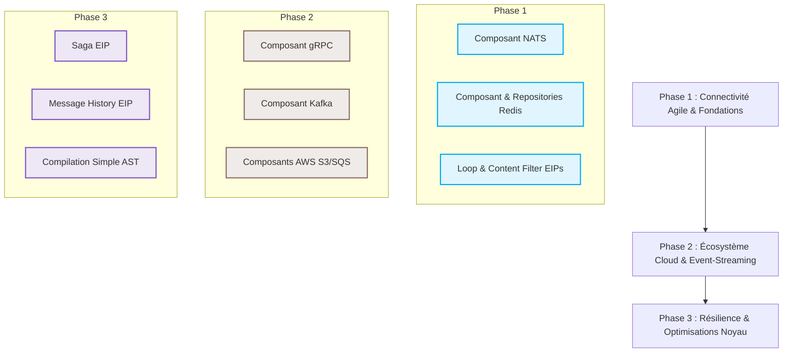

# Feuille de Route GoCamel : Évolutions des EIPs et Composants 🚀

Ce document dresse une analyse stratégique et technique des opportunités d'extension de la bibliothèque **GoCamel** (le portage Go inspiré d'**Apache Camel**). Il identifie les modèles d'intégration d'entreprise (EIP) et les composants manquants les plus pertinents à ajouter afin de propulser ce projet au rang de framework d'intégration de référence pour l'écosystème Go.

---

## 🗺️ Vision Stratégique & Positionnement de GoCamel

GoCamel se distingue par sa légèreté, son respect des idiomes Go (utilisation massive des structures thread-safe, des Goroutines et des contextes de cycle de vie), et un moteur de traitement extrêmement robuste. 

Pour passer d'une excellente bibliothèque locale à un framework d'intégration distribué de niveau industriel, la roadmap doit s'articuler autour de trois axes :
1. **L'orientation Cloud-Native & Microservices** : Intégrer les protocoles modernes (gRPC, NATS).
2. **Le support des architectures pilotées par les événements (EDA)** : Connexion native aux brokers majeurs (Kafka, AWS SQS).
3. **L'autonomie transactionnelle** : Faciliter la résilience dans les réseaux de services distribués (Saga Pattern).



---

## 🧩 1. Nouveaux Patterns d'Intégration d'Entreprise (EIP) Recommandés

Bien que GoCamel implémente déjà des piliers comme le `Splitter`, le `CircuitBreaker`, le `Resequencer` et le `ClaimCheck`, l'ajout de patterns plus avancés permettrait de simplifier des architectures complexes.

### A. Saga EIP (Pattern de Transaction Distribuée)
> [!IMPORTANT]
> Dans une architecture de microservices, la gestion des transactions sur plusieurs bases de données ne peut pas reposer sur des protocoles de commit à deux phases (2PC) trop lourds. Le pattern **Saga** coordonne une série de transactions locales et applique des actions de compensation en cas d'erreur.

* **Pourquoi dans GoCamel** : Fournir une gestion transactionnelle native pour les microservices Go.
* **Proposition de Design Go** :
  Création d'un `SagaProcessor` stockant des actions et des fonctions de compensation (sous forme d'autres routes ou de processeurs personnalisés) associés à un `SagaService` gérant la persistance de l'état.
* **Exemple de DSL ciblé** :
  ```go
  route, _ := ctx.CreateRouteBuilder().
      From("direct:bookTrip").
      Saga().
          Action("direct:reserveFlight").
          Compensation("direct:cancelFlight").
      To("direct:reserveHotel").
          Compensation("direct:cancelHotel").
      Build()
  ```

### B. Loop EIP (Traitement Récursif ou Répétitif)
* **Description** : Permet de traiter le message en boucle un nombre défini de fois (fixe ou dynamique basé sur une expression Simple).
* **Pourquoi dans GoCamel** : Très utile pour simuler des mécanismes de polling, de l'envoi répété, ou des transformations itératives internes de charges de données.
* **Proposition de Design Go** :
  ```go
  type LoopProcessor struct {
      loopCountExpr Expression
      processor     Processor
  }
  ```
* **Exemple de DSL ciblé** :
  ```go
  // Boucle dynamique basée sur un en-tête
  route.Loop().Simple("${header.retryCount}").
      To("direct:tryProcess")
  ```

### C. Content Filter EIP & Transform
* **Description** : Permet d'extraire, de filtrer ou de restructurer le contenu d'un message afin de ne conserver que les données requises pour le système destinataire (à la différence du *Message Filter* qui supprime complètement le message de la route).
* **Pourquoi dans GoCamel** : Permettre des transformations légères de structures JSON ou XML à la volée.
* **Proposition de Design Go** :
  ```go
  // DSL ciblé
  route.Transform().Body(func(body any) (any, error) {
      // Transformation de structure Go à la volée
      return newBody, nil
  })
  ```

### D. Message History EIP
* **Description** : Enregistre le chemin complet suivi par un `Exchange` à travers tous les processeurs qu'il traverse (avec horodatages et durée d'exécution).
* **Pourquoi dans GoCamel** : Crucial pour le diagnostic de bogues, l'observabilité et le traçage distribué, s'associant parfaitement avec l'actuel package d'observabilité OpenTelemetry (`otel.go`).
* **Design Go** :
  Un tableau de structures `MessageHistoryEntry` attaché à l'objet `Exchange` mis à jour de manière transparente par le moteur d'exécution des routes.
  ```go
  type MessageHistoryEntry struct {
      NodeID    string
      Timestamp time.Time
      Elapsed   time.Duration
  }
  ```

---

## 🔌 2. Nouveaux Composants Recommandés pour GoCamel

L'écosystème Go excelle dans les systèmes distribués. Les nouveaux composants doivent capitaliser sur des technologies modernes, ultra-performantes et fortement plébiscitées par les développeurs Go.

| Composant | Schéma d'URI | Librairie Go de Référence | Cas d'Usage Majeur |
| :--- | :--- | :--- | :--- |
| **gRPC** | `grpc://host:port/Service/Method` | `google.golang.org/grpc` | Communication inter-microservices synchrone ultra-rapide |
| **Kafka** | `kafka:topic?brokers=localhost:9092` | `github.com/segmentio/kafka-go` | Streaming d'événements et messagerie distribuée industrielle |
| **NATS** | `nats:subject?servers=localhost:4222` | `github.com/nats-io/nats.go` | Messagerie ultra-légère cloud-native, JetStream inclus |
| **Redis** | `redis://host:port?command=GET&key=x` | `github.com/redis/go-redis/v9` | Cache, Idempotent/Aggregation Repository distribués |
| **AWS S3 / SQS**| `aws2-sqs://queue-name?region=us-east-1` | `github.com/aws/aws-sdk-go-v2` | Intégration cloud serverless et queues managées |

---

### A. Composant gRPC (`grpc:`)
Go est le langage de prédilection pour implémenter des microservices gRPC. Un composant gRPC permettrait d'exposer des routes GoCamel en tant que serveurs gRPC (Consumer) ou de consommer des API gRPC externes (Producer).

* **Architecture du Consumer** :
  Génère dynamiquement un serveur gRPC ou s'enregistre sur un serveur existant. Les requêtes entrantes sont encapsulées dans un `Exchange` Camel et envoyées sur la route.
* **Architecture du Producer** :
  Utilise la réflexion gRPC ou des descripteurs de proto pour sérialiser le corps du message (`body`) et appeler la méthode cible sur le serveur gRPC de destination.

```
                  ┌─────────────────┐
Request (gRPC) ──>│  gRPC Consumer  │──> (Exchange) ──> GoCamel Route
                  └─────────────────┘
```

---

### B. Composant NATS (`nats:`)
> [!TIP]
> NATS et JetStream sont écrits en Go et offrent des performances de messagerie époustouflantes (faible latence, haut débit). C'est le composant d'intégration par excellence pour GoCamel.

* **Implémentation** :
  * **Consumer** : S'abonne à un sujet (Subject) NATS ou à un groupe de consommateurs (Queue Group) pour répartir la charge de travail entre les instances de l'application GoCamel.
  * **Producer** : Publie le body de l'échange sur le sujet NATS.
  * Prise en charge transparente de JetStream pour garantir la persistance des messages et une livraison de type "At-Least-Once".

---

### C. Composant Kafka (`kafka:`)
Apache Kafka est incontournable dans le traitement des flux de données d'entreprise.
* **Choix technique de bibliothèque** :
  Privilégier `github.com/segmentio/kafka-go` au lieu de `confluent-kafka-go`. Le client Segmentio est écrit en Go pur, évitant ainsi le besoin de compilation CGO (ce qui simplifie énormément la portabilité et les builds Docker).
* **Fonctionnalités clés** :
  * Support de la gestion des offsets (manuelle ou automatique).
  * Alignement avec les propriétés standard de Camel (ex: `CamelKafkaKey`, `CamelKafkaOffset`).
  * Concurrence configurable via un pool de Workers internes pour consommer en parallèle sur plusieurs partitions.

---

### D. Composant Redis (`redis:`)
Redis ne doit pas seulement servir de producteur de commandes (`GET`, `SET`, `PUBLISH`). Son intégration apporte des briques structurelles à GoCamel :
* **Redis Idempotent Repository** : Permet au pattern *Idempotent Consumer* de stocker de manière centralisée les clés de messages déjà traités (idéal pour un déploiement multi-instances de GoCamel).
* **Redis Aggregation Repository** : Permet à l'EIP *Aggregator* de sauvegarder l'état des agrégations en cours dans une base Redis persistante au lieu d'une carte en mémoire (`memory_aggregation_repository.go`), évitant la perte de messages en cas de crash applicatif.

---

### E. Composants AWS (S3 et SQS)
Faciliter les intégrations cloud hybrides :
* **`aws2-s3`** :
  * *Consumer* : Scrute (polling) un bucket S3 pour télécharger de nouveaux fichiers de manière incrémentale.
  * *Producer* : Téléverse le corps du message (chaîne, octets ou flux `io.Reader`) vers un bucket cible.
* **`aws2-sqs`** : Messagerie asynchrone serverless simple et robuste, s'associant à l'architecture de Goroutines de GoCamel.

---

## ⚡ 3. Améliorations Techniques Spécifiques au Moteur Go

L'avantage majeur de GoCamel sur Java Camel réside dans la gestion de la concurrence propre à Go. Les propositions ci-dessous exploitent le runtime de Go pour optimiser les performances internes.

### A. Composant Go Channel (`chan:`)
Permettre une connexion transparente entre le code Go applicatif natif et les routes de GoCamel via des canaux standard Go.
* **Exemple d'URI** : `chan:orderChannel?bufferSize=100`
* **Fonctionnement** :
  * Un producteur écrit dans le canal `chan *Exchange`.
  * Un consommateur lit de manière bloquante depuis ce canal dans une Goroutine dédiée. Cela permet d'éliminer la surcharge de SEDA dans les cas d'intégration strictement intra-processus.

### B. Compilation AST & Optimisation du Simple Language
Le Simple Language actuel (`simple_language_eval.go`) interprète et évalue l'expression textuelle pour chaque échange de manière dynamique.
* **Recommandation technique** :
  Introduire une phase de compilation de l'expression lors du démarrage de la route (au moment de l'appel à `Build()`). L'expression textuelle est analysée une seule fois et transformée en un arbre de syntaxe abstraite (AST) ou compilée sous forme d'une chaîne imbriquée de fonctions (closures) pré-compilées.
* **Bénéfice** :
  Divise par 5 à 10 le coût CPU d'évaluation des expressions simples à forte volumétrie de messages.

### C. Pool de Producteurs Dynamiques (Producer Cache)
Comme identifié lors de la revue de code, le processeur de destination dynamique (ToD) recrée et détruit des producteurs de manière répétitive.
* **Recommandation technique** :
  Mettre en place une structure `ProducerCache` thread-safe (protégée par un `sync.RWMutex`) dans le `CamelContext`. Ce cache conserve les producteurs actifs (ex: clients HTTP, connexions FTP) et utilise une stratégie d'éviction de type LRU (Least Recently Used) pour libérer les ressources inactives sans surcharger les sockets système.

---

## 📅 4. Plan de Livraison suggéré (Phases)

### 🚀 Phase 1 : Connectivité Interne & Fondations (Mois 1 - 2)
Focus sur l'extension des fonctionnalités locales et la mémoire partagée.
* Implémentation du **Loop EIP** et des processeurs **Transform / Content Filter**.
* Développement du composant **Redis** (permettant la mise en place du `RedisIdempotentRepository`).
* Création du composant **Go Channel (`chan:`)** pour faciliter l'intégration de GoCamel au sein d'applications Go hôtes.

### 🌤️ Phase 2 : Écosystème Distribué & Cloud (Mois 3 - 4)
Focus sur l'intégration des flux de données et le déploiement cloud.
* Développement des connecteurs **NATS** (grâce à son intégration idiomatique en Go).
* Développement du connecteur **gRPC** pour standardiser les API inter-microservices.
* Ajout du connecteur **Kafka** en pur Go (via `segmentio/kafka-go`).
* Écriture des composants **AWS S3 / SQS** à l'aide du SDK AWS v2.

### 🛡️ Phase 3 : Architectures Avancées & Résilience (Mois 5 - 6)
Focus sur la tolérance aux pannes à large échelle et l'optimisation extrême des performances.
* Implémentation de la **Saga EIP** pour coordonner les compensations logiques.
* Ajout du support global du **Message History EIP** et intégration plus fine avec OpenTelemetry pour le traçage distribué.
* Refactoring du Simple Language pour intégrer la pré-compilation (AST / Closures).
* Implémentation du **ProducerCache** pour optimiser le routing dynamique (`ToD`).

---

## 🎯 Conclusion

Avec son socle technique de haute qualité, **GoCamel** possède tous les atouts pour s'imposer. L'application de cette roadmap technique renforcera sa flexibilité et offrira aux développeurs Go un framework d'intégration robuste, moderne, et parfaitement taillé pour l'ère du cloud-native et des architectures événementielles distribuées.
